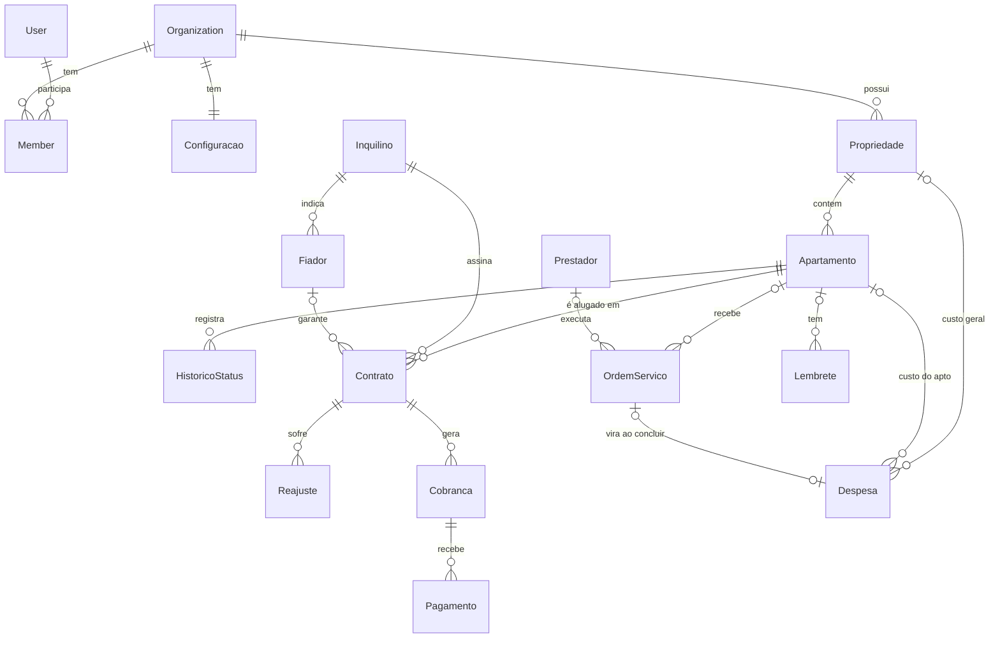

# Isis-Assist — Plano do MVP

> Arquitetura e roteiro de implementação. Versão 1 — aprovado em 21/10/2026.

**Andamento:** Fase 0 concluída (21/10/2026). Fase 1 concluída (22/10/2026). Próxima: Fase 2 — Contratos.

Sistema web (PWA) de gestão de aluguéis residenciais para substituir as planilhas da proprietária.
Prioridades, nesta ordem: **simples para quem não é técnica**, **ótimo no celular**, **bonito**.

---

## 1. Stack

| Camada | Escolha |
|---|---|
| Framework | Next.js (App Router, versão estável mais recente) + TypeScript |
| Interface | Tailwind CSS + shadcn/ui + lucide-react · next-themes (claro/escuro) · sonner (avisos) · Recharts (gráficos via shadcn/charts) |
| Formulários | react-hook-form + zod — o mesmo esquema valida no navegador e no servidor, com mensagens em PT-BR |
| Banco | PostgreSQL + Prisma |
| Login | Better Auth — e-mail/senha, recuperação de senha, sessões no banco, plugin de organizações |
| Arquivos | Camada `storage` com dois drivers: disco local (dev) e S3-compatível (produção: Supabase Storage ou Cloudflare R2) |
| PDF | @react-pdf/renderer (recibo, relatórios, informe de IR) |
| Excel | exceljs para exportar; leitura de .xlsx/.csv no navegador para a importação (prévia instantânea) |
| Datas | date-fns com locale pt-BR; fuso America/Sao_Paulo |
| Testes | Vitest (regras de negócio) + Playwright (fluxos críticos em tela de celular) |
| Hospedagem sugerida | Vercel (região São Paulo) + Supabase (Postgres + Storage, região São Paulo) + Resend (e-mails de senha) |

### Prisma + Postgres próprio × Supabase "completo"

**Recomendação: Prisma + PostgreSQL + Better Auth.** O Supabase entra só como *hospedagem* do Postgres e dos
arquivos em produção — não usamos Supabase Auth nem supabase-js.

1. **Regras de negócio em TypeScript, numa transação.** "Ativar contrato" = muda o status do apto + grava o
   histórico + gera a primeira cobrança, tudo ou nada. Com Prisma isso é uma função tipada e testável; no
   Supabase puro viraria função SQL (RPC) ou várias chamadas soltas do navegador.
2. **Multi-tenant fácil de auditar.** Toda tabela tem `organizationId` e todo acesso passa por uma camada
   única que recebe o contexto da conta. O RLS do Supabase é poderoso, mas são políticas SQL difíceis de
   testar e manter sozinho — dá para ligá-lo depois como segunda camada de proteção.
3. **Relatórios.** Agregações por mês, apto e categoria são diretas em Prisma/SQL; com supabase-js ficam
   desajeitadas.
4. **Login pronto e nosso.** Better Auth já traz e-mail/senha, "esqueci a senha", limite de tentativas e
   organizações com papéis e convites. No v2, o portal do inquilino é só mais um papel.
5. **Sem lock-in e sem Docker no dev.** Roda no PostgreSQL 17 que já está instalado na máquina; em produção,
   qualquer Postgres gerenciado serve.
6. **Quando o Supabase completo ganharia:** se precisássemos de realtime ou de um app sem backend próprio.
   Não é o caso.

---

## 2. Modelagem do banco

### Convenções

- Toda tabela de domínio tem `organizationId` (indexado), `createdAt`, `updatedAt`.
- **Dinheiro em centavos (`Int`)**: sem erro de arredondamento e vai direto para o navegador. Percentuais em `Decimal`.
- **Datas de calendário** (vencimento, início/fim de contrato, competência) em `@db.Date` — evita o clássico
  "mostra o dia anterior" por causa do fuso.
- Excluir = **arquivar** (`arquivadoEm`). Nada financeiro é apagado de verdade.
- Nomes do domínio em português (`Apartamento`, `Cobranca`…); tabelas do Better Auth em inglês (são da biblioteca).
- Unicidades sempre por conta (ex.: CPF único dentro da conta, não no sistema todo).

### Diagrama



`Arquivo` se liga (por chaves opcionais) a Apartamento, Inquilino, Fiador, Contrato, Pagamento, Despesa e
OrdemServico. `Atividade` registra quem fez o quê, para as abas de histórico.

### Entidades

**Conta e acesso** (Better Auth)
- `User` — nome, e-mail, senha (em `Account`, com hash), sessões em `Session`, tokens em `Verification`.
- `Organization` — **a conta do proprietário** (o "tenant"). Nome, slug, logo.
- `Member` — usuário × conta, papel `owner | admin | member` (ex.: convidar uma ajudante depois).
- `Configuracao` (1:1 com a conta) — dados do locador para o recibo (nome, CPF/CNPJ, endereço, chave PIX),
  multa %, juros % ao mês, dias de carência, próximo número de recibo.

**Imóveis**
- `Propriedade` — nome ("Residencial Isis"), endereço completo (CEP, rua, número, bairro, cidade, UF).
  Se a conta tem uma só, a interface esconde o seletor de propriedade.
- `Apartamento` — propriedade, identificação ("203", único na propriedade), andar, bloco?, descrição,
  quartos?, área m²?, valor de referência, **status** `LIVRE | OCUPADO | RESERVADO | REFORMA | MANUTENCAO`.
- `HistoricoStatus` — apto, de → para, motivo, origem `MANUAL | CONTRATO | MANUTENCAO | LEMBRETE`, quem, quando.

**Pessoas**
- `Inquilino` — nome, CPF, RG?, nascimento?, telefone/WhatsApp, e-mail, profissão?, renda?,
  contato de emergência (nome, telefone, parentesco), observações.
- `Fiador` — inquilino, nome, CPF, telefone, e-mail, endereço.
- `Prestador` — nome, especialidade (encanador, eletricista, pintor…), telefone, e-mail, CPF/CNPJ?, chave PIX?, observações.

**Contratos**
- `Contrato` — apto, inquilino, fiador?, início, fim, valor do aluguel atual, dia de vencimento (1–31),
  caução (valor, devolvida em, valor devolvido), índice de reajuste `IGPM | IPCA | FIXO | NENHUM`,
  % fixo?, próxima data de reajuste, multa/juros próprios? (sobrescrevem a conta),
  status `RASCUNHO | ATIVO | ENCERRADO`, encerramento (data, motivo).
  **Um único contrato ativo por apto** (índice único parcial no Postgres).
- `Reajuste` — contrato, data-base, índice, % aplicado, valor anterior, valor novo, quem aplicou.
- `IndiceEconomico` — global (sem conta): índice, competência, variação % do mês. Cache da API do Banco Central.

**Financeiro**
- `Cobranca` — contrato, apto e inquilino (cópias para consulta rápida), tipo `ALUGUEL | CAUCAO | OUTRA`,
  competência (mês), vencimento, valor, descrição, status `PENDENTE | PARCIAL | PAGO | CANCELADO`,
  `chaveGeracao` única (`contrato:AAAA-MM`) — rodar a geração duas vezes nunca duplica.
  **"Atrasado" não é gravado: é calculado** (vencimento + carência < hoje e não quitado), então nunca fica desatualizado.
- `Pagamento` — cobrança, data, valor pago, multa, juros, desconto, forma `PIX | DINHEIRO | TRANSFERENCIA | OUTRA`,
  comprovante?, número do recibo (sequencial por conta). Vários pagamentos por cobrança = pagamento parcial.
- `Despesa` — propriedade? e/ou apto? (nenhum = geral), categoria `IPTU | CONDOMINIO | AGUA | LUZ | GAS |
  INTERNET | MANUTENCAO | SEGURO | TAXAS | OUTROS`, descrição, valor, data, pago?, comprovante?,
  ordem de serviço de origem? (única).

**Manutenção e rotina**
- `OrdemServico` — apto? (vazio = área comum), prestador?, título, descrição, prioridade
  `BAIXA | MEDIA | ALTA | URGENTE`, status `ABERTA | EM_ANDAMENTO | CONCLUIDA | CANCELADA`,
  custo estimado, custo final, aberta em, concluída em, `statusAnteriorApto` (para restaurar).
- `Lembrete` — apto?, título, descrição, data/hora? (sem data = anotação), prioridade,
  recorrência `NENHUMA | SEMANAL | MENSAL | ANUAL`, concluído em, ação sugerida, origem `USUARIO | SISTEMA`.

**Apoio**
- `Arquivo` — chave no storage, nome original, tipo, tamanho, categoria (`FOTO_APTO | DOCUMENTO | CONTRATO_PDF |
  COMPROVANTE | FOTO_OS`) e as chaves opcionais para a entidade dona.
- `Atividade` — quem, o quê, em qual entidade, resumo legível ("Registrou pagamento de R$ 1.500,00 do apto 203").
- `Importacao` — tipo, arquivo, mapeamento de colunas, totais, erros. Registros importados guardam
  `importacaoId` → dá para **desfazer uma importação** inteira.

### Regras de negócio principais

1. **Ativar contrato** (uma transação): apto precisa estar Livre ou Reservado (Reforma/Manutenção → aviso e
   confirmação) → apto vira Ocupado + histórico → gera a cobrança do mês (primeiro mês proporcional, opcional).
2. **Encerrar contrato**: data de saída, devolução da caução, novo status do apto (padrão **Livre**, com opção
   de Reforma), cobranças futuras em aberto são canceladas.
3. **Geração mensal de cobranças**: rotina diária (cron) + gatilho ao abrir o painel; idempotente pela
   `chaveGeracao`. Vencimento dia 31 em fevereiro → último dia do mês.
4. **Multa e juros**: multa % única + juros % ao mês pro rata dia, configuráveis na conta e por contrato.
   Calculados como sugestão ao registrar o pagamento, com botão "isentar".
5. **Reajuste**: data-base = aniversário do contrato; vira alerta 30 dias antes. IGP-M/IPCA acumulado em 12
   meses vem da API pública do Banco Central (SGS, séries 189 e 433), com opção de digitar à mão. Ao aplicar,
   grava o `Reajuste` e as cobranças a partir da data-base usam o novo valor. Índice negativo → pergunta.
6. **Ordem de serviço**: ao abrir, pergunta se o apto vai para Manutenção (sugestão "sim" se Livre/Reservado,
   "não" se Ocupado — com inquilino morando, o status continua Ocupado e o card ganha um selo 🔧).
   Ao concluir com custo: cria a `Despesa` automaticamente e pergunta se o apto volta ao status anterior.
7. **Lembretes**: ao concluir um recorrente, nasce a próxima ocorrência. Palavras-chave (encanador, vazamento,
   eletricista, pintura, conserto…) sugerem ação: "Colocar apto em manutenção" / "Abrir OS".
   Lembretes do sistema (contrato vencendo, reajuste chegando) aparecem sozinhos.
8. **Recibo**: numeração sequencial por conta; PDF com dados do locador, inquilino, apto, competência, valores
   e forma de pagamento; botão "Enviar pelo WhatsApp".
9. **Informe de IR**: regime de caixa (data do pagamento), por mês e por inquilino (CPF), separando despesas
   dedutíveis pagas pelo locador (IPTU, condomínio) — o formato que o contador e o Carnê-Leão usam.

---

## 3. Estrutura de pastas

```
isis-assist/
├── prisma/
│   ├── schema.prisma
│   ├── migrations/
│   └── seed/                     # demonstração: 12 aptos e 12 meses de histórico
├── public/icones/                # ícones do PWA
├── docs/                         # PLANO.md, V2.md
├── src/
│   ├── app/
│   │   ├── (publico)/            # entrar, criar-conta, esqueci-a-senha, redefinir-senha
│   │   ├── (app)/                # área logada: menu inferior (celular) / lateral (desktop)
│   │   │   ├── page.tsx          # Painel
│   │   │   ├── apartamentos/     # mapa/lista, [id], novo
│   │   │   ├── inquilinos/
│   │   │   ├── contratos/        # lista, novo (assistente), [id]
│   │   │   ├── financeiro/       # cobrancas, despesas, relatorios, imposto-de-renda
│   │   │   ├── manutencoes/      # ordens, prestadores
│   │   │   ├── lembretes/        # lista | calendario
│   │   │   ├── importar/
│   │   │   └── configuracoes/
│   │   ├── (portal)/             # v2 — portal do inquilino (reservado)
│   │   ├── api/
│   │   │   ├── auth/[...all]/    # Better Auth
│   │   │   ├── arquivos/[id]/    # download autenticado (confere a conta)
│   │   │   ├── pdf/              # recibo, relatórios, informe de IR
│   │   │   ├── excel/            # exportações
│   │   │   ├── cron/diario/      # cobranças, índices, lembretes do sistema
│   │   │   └── webhooks/         # v2 — PIX
│   │   ├── manifest.ts           # PWA
│   │   └── layout.tsx
│   ├── modulos/                  # um por módulo do MVP
│   │   └── contratos/            # (mesmo formato em todos)
│   │       ├── componentes/      # telas e formulários
│   │       ├── acoes.ts          # server actions: valida (zod) → chama o serviço
│   │       ├── consultas.ts      # leituras, sempre filtradas pela conta
│   │       ├── servico.ts        # regras de negócio e transações (testável sem tela)
│   │       └── esquemas.ts       # zod compartilhado navegador/servidor
│   ├── components/
│   │   ├── ui/                   # shadcn
│   │   ├── layout/               # casca do app, menu inferior, barra lateral, botão "+"
│   │   ├── campos/               # CPF, telefone, moeda, data, upload de foto
│   │   └── comum/                # estado vazio, selo de status, confirmação, gaveta
│   ├── server/
│   │   ├── db.ts                 # Prisma
│   │   ├── auth.ts               # Better Auth
│   │   ├── contexto.ts           # exigirContexto(): sessão + conta ativa (multi-tenant)
│   │   ├── storage/              # local | s3
│   │   ├── indices/              # IGP-M / IPCA (Banco Central)
│   │   ├── pdf/                  # modelos de recibo e relatórios
│   │   └── integracoes/          # v2: pagamentos/ (asaas, efi) e notificacoes/ (whatsapp)
│   ├── lib/                      # puro: formatar R$ e datas, CPF, máscaras, cálculo de vencimento
│   └── proxy.ts                  # redireciona quem não está logado
└── tests/                        # vitest (regras) + playwright (fluxos)
```

---

## 4. Telas

**Navegação no celular:** menu inferior com 5 itens — **Início · Aptos · Financeiro · Lembretes · Mais**
(Mais = Inquilinos, Contratos, Manutenções, Importar, Configurações) — e um botão **+** flutuante com as ações
rápidas: Registrar pagamento, Novo contrato, Nova despesa, Abrir OS, Novo lembrete.
No desktop, o mesmo conteúdo vira barra lateral.

| Área | Telas |
|---|---|
| Acesso | Entrar · Criar conta · Esqueci a senha · Redefinir senha |
| Primeiro uso | Boas-vindas: nome e endereço do residencial → "quantos andares e aptos por andar?" gera os aptos em lote (ou "importar da planilha") |
| Painel | Mapa dos aptos por andar (cor + ícone + nome do inquilino + selos de atraso e 🔧) · ocupação · previsto × recebido no mês · total em atraso · a receber hoje/semana · contratos vencendo 30/60/90 · reajustes próximos · lembretes da semana · gráfico receita × despesas 12 meses |
| Apartamentos | Mapa/lista com filtro por status · Detalhe com abas (Resumo · Financeiro · Manutenções · Lembretes · Histórico de inquilinos e status) · Formulário · Trocar status (gaveta com motivo) |
| Inquilinos | Lista com busca · Detalhe (dados, fiador, emergência, documentos, contratos, pagamentos, botão WhatsApp) · Formulário |
| Contratos | Lista (ativos, vencendo, encerrados) · **Assistente de novo contrato** (apto livre → inquilino existente ou novo → valores pré-preenchidos → revisar → ativar) · Detalhe (cobranças, reajustes, PDF) · Encerrar · Aplicar reajuste |
| Financeiro | Cobranças do mês (pendentes, atrasadas, pagas) · **Registrar pagamento** (gaveta: valor já preenchido com multa/juros, data de hoje, PIX → confirmar) · Recibo PDF · Despesas · Relatórios mensal/anual (PDF e Excel) · Informe de IR |
| Manutenções | Ordens de serviço (lista com filtros; colunas por status no desktop) · Detalhe/formulário com fotos · Prestadores |
| Lembretes | Lista (atrasados, hoje, semana, depois, concluídos) · Calendário mensal · Formulário |
| Importar | Tipo → enviar arquivo → **mapear colunas** → prévia com erros apontados → confirmar → resultado (com "desfazer") |
| Configurações | Dados do locador (saem no recibo) · Propriedades · Multa, juros e carência · Aparência (claro/escuro) · Trocar senha |

**Princípios de UX**
- Registrar um pagamento: Painel → toque na cobrança → Confirmar (3 toques).
- Gavetas que sobem de baixo (sheets) no celular em vez de páginas novas para ações rápidas.
- Máscaras e teclado certo (numérico para CPF, telefone e valores); validação ao sair do campo, em frase simples.
- Estados vazios que ensinam o próximo passo ("Nenhum apartamento ainda — Cadastrar / Importar planilha").
- Status sempre com cor **e** ícone **e** texto (funciona no escuro e para daltônicos).
- Fotos comprimidas no próprio celular antes do envio.
- Desfazer em vez de "tem certeza?" sempre que possível.

---

## 5. Fases

Cada fase termina com o projeto rodando e o seed atualizado para demonstrar o que foi feito.

| Fase | Entrega | Ao final, dá para… |
|---|---|---|
| **0 — Fundação** | Next + Tailwind + shadcn, identidade visual, tema claro/escuro, casca do app (menu inferior/lateral), Prisma + Postgres, Better Auth (criar conta, entrar, recuperar senha), conta + propriedade no cadastro, contexto multi-tenant, utilitários BR (R$, datas, CPF, máscaras), PWA instalável | criar conta, entrar e instalar o app no celular |
| **1 — Aptos e inquilinos** | Storage de arquivos, CRUD de aptos com fotos, status com histórico, geração em lote, mapa no painel, CRUD de inquilinos com fiador, emergência, documentos e WhatsApp | ver o residencial no mapa e cadastrar pessoas |
| **2 — Contratos** | Assistente, ativar/encerrar (status automático), PDF anexo, reajuste (IGP-M/IPCA/fixo) com alerta e cálculo, detalhe do apto completo | alugar e desocupar um apto de ponta a ponta |
| **3 — Financeiro** | Geração mensal idempotente + cron, atraso calculado, multa/juros, pagamento total/parcial com comprovante, recibo PDF, mensagens de cobrança/recibo no WhatsApp, despesas | substituir a planilha de recebimentos |
| **4 — Manutenções** | Ordens de serviço com fotos, prestadores, pergunta de status do apto, custo → despesa automática | controlar consertos e seu custo |
| **5 — Lembretes** | Anotações e lembretes, recorrência, lista e calendário, ações sugeridas, lembretes do sistema | organizar a rotina |
| **6 — Painel e relatórios** | Métricas completas, vencimentos 30/60/90, gráfico 12 meses, relatórios mensal/anual em PDF e Excel, informe de IR | apresentar números e entregar ao contador |
| **7 — Importação** | Leitura de .xlsx/.csv, mapeamento de colunas, prévia com erros, importação de aptos/inquilinos/contratos, desfazer | migrar as planilhas da cliente |
| **8 — Acabamento e venda** | Seed de demonstração caprichado, página offline, revisão mobile e acessibilidade, testes dos fluxos críticos, deploy, docs do v2 | demonstrar e vender |

---

## 6. Preparação para o v2 (sem implementar)

- **Portal do inquilino**: `Inquilino.usuarioId` opcional; o contexto de acesso já carrega um papel
  (`GESTOR` hoje, `INQUILINO` amanhã), então as consultas já nascem prontas para filtrar "só o que é dele".
  Grupo de rotas `(portal)` reservado.
- **Cobrança via PIX (Asaas/Efí)**: interface `GatewayPagamento` (criar cobrança, consultar, cancelar,
  validar webhook) em `server/integracoes/pagamentos`, com implementação "manual" no MVP.
  Campos opcionais já no banco: `Cobranca.gateway*` (id externo, PIX copia-e-cola, link) e
  `Inquilino.gatewayClienteId`; `Pagamento.origem` `MANUAL | GATEWAY`. Rota `api/webhooks/[provedor]` reservada.
- **WhatsApp**: interface `Notificador`. No MVP a implementação abre o WhatsApp da própria usuária com a
  mensagem pronta (link `wa.me`, custo zero). No v2 troca para API (WhatsApp Cloud API ou similar) +
  tabela de fila de envios. `Inquilino.aceitaWhatsapp` já existe (consentimento — LGPD).

---

## 7. Pontos em aberto

- **Planilhas atuais da cliente** — uma cópia (mesmo anonimizada) valida o modelo e define a importação.
- ~~Banco local~~ — resolvido na Fase 0 com `prisma dev` (Postgres local do Prisma, sem Docker nem senha).
  Para usar o PostgreSQL 17 instalado, basta trocar as URLs no `.env`.
- **Hospedagem e custo** — decidir na Fase 8. Para vender, Vercel exige o plano Pro (o gratuito é só para uso
  não comercial); alternativa mais barata: VPS com Coolify.
- **E-mail de recuperação de senha** — em dev o link aparece no terminal; em produção, Resend com domínio próprio.
